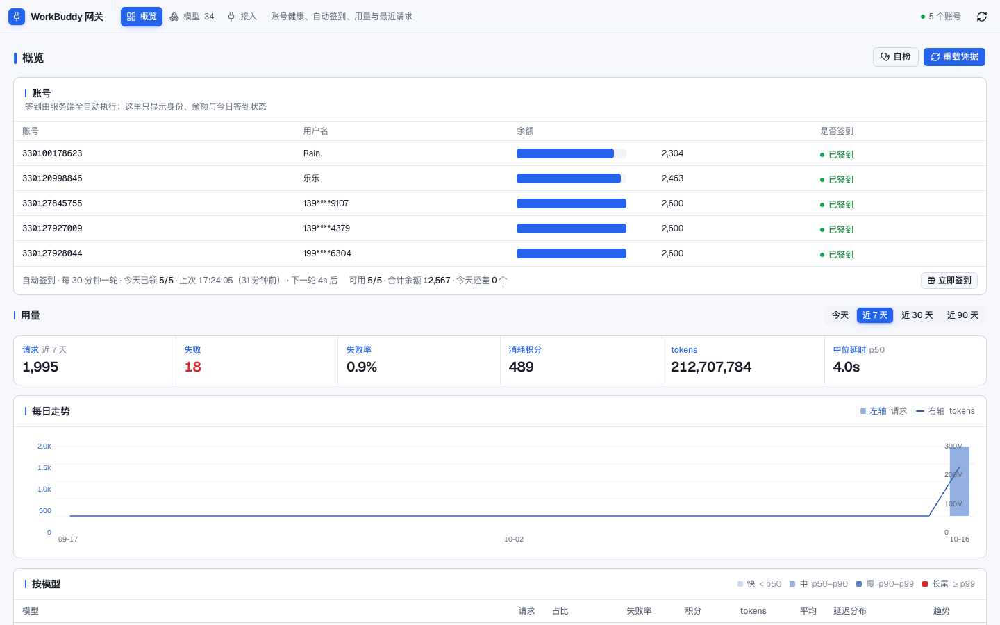
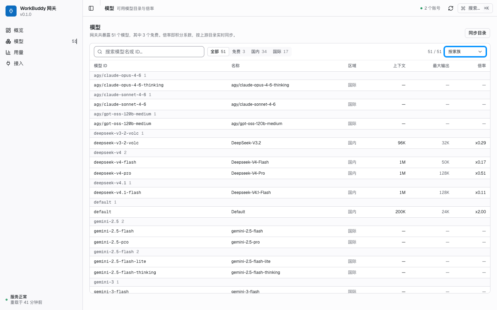
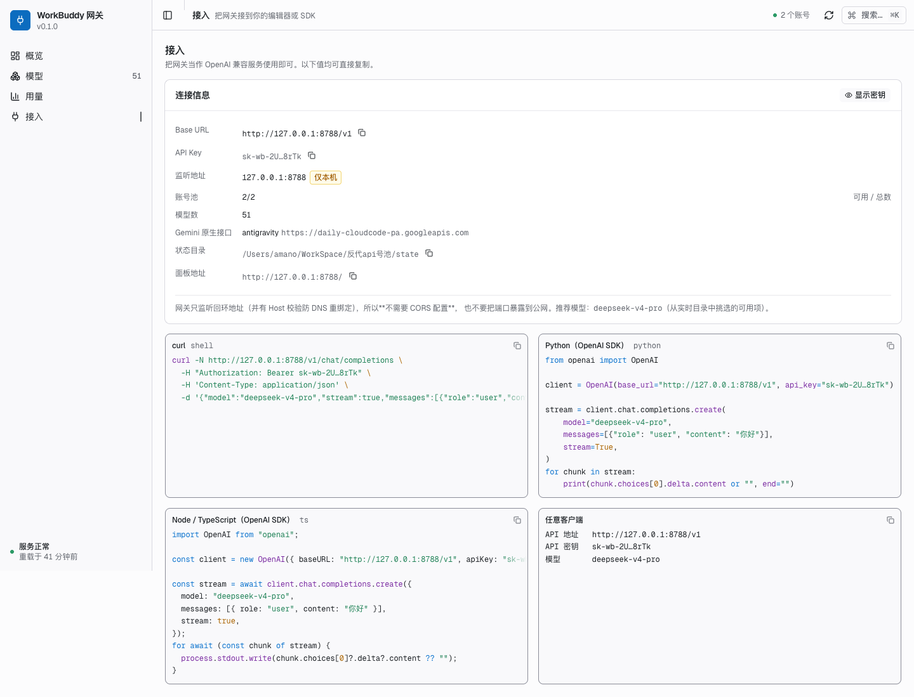

# WorkBuddy 统一网关

把一个**本机已登录的 WorkBuddy** 变成 OpenAI 兼容 API，供其他 AI harness（Cursor / Claude Code / Cherry Studio / 各类 SDK）直接调用。

- **WorkBuddy 侧只接国内版**（国际版已移除），另有一条**独立的 Gemini 上游**（AI Studio 或本机 Antigravity 免费档）
- 后端零第三方依赖（纯 Python 标准库）
- 只绑 `127.0.0.1`，不对外暴露
- 多账号池 + 失败自动换号
- 凭据自动续期（30 天 token，无需重新登录）
- **全自动签到**：网关每天自己把号池的签到奖励领掉（带抖动与账号间隔），面板只显示结果；
  不想等就在账号面板点「立即签到」

> **关于依赖**：网关进程本身仍然是纯 Python 标准库，`./run.sh` 直接起，不需要 pip 装任何东西。
>
> 控制台前端在 2026-10-16 完全重写为 **React 19 + Vite 8 + Tailwind v4 + shadcn/ui**，
> 构建产物（HTML / JS / CSS / 字体，约 1.2 MB）**提交进仓库**，所以运行时依然不需要 Node，
> 也不需要联网 —— 「断网也能打开面板」这条继续成立。只有改前端时才需要 Node + pnpm，
> 见下面「控制台前端」。
>
> ⚠️ 更正一条此前写错的说法：**打包的 Python 是可以安装原生 wheel 的**。
> 实测 `dsh-primary-runtime` 里那个 3.12.14 自带可用的 pip 26.2.1，
> 且 numpy 2.3.5 / lxml 6.1.3 / pillow 12.3.0 / pandas 3.0.1 均已装好并能正常 import。
> 所以后端不引第三方依赖是**设计选择**（减少部署面），不是能力所限。

---

## 快速开始

```bash
./run.sh
```

首次启动会自动生成一把 `sk-wb-…` 开头的 API key 并写进 `.env`（权限 600）。日志里的启动信息会告诉你要填的 base_url。

```
网关启动：http://127.0.0.1:8788
base_url 填：http://127.0.0.1:8788/v1
```

打开 <http://127.0.0.1:8788/> 就是控制台。



三个页签，都用 **HashRouter** 深链（URL 形如 `#/models?facet=free`）：

| 页签 | 内容 |
|---|---|
| 概览 | 账号列表（**账号 / 用户名 / 余额 / 是否签到** 四项，余额是横向量级条 + 自动签到状态）、用量区块（窗口选择 · 6 项 KPI · 每日柱+线 · 按模型明细）、**最底部**的最近请求日志、**只在出问题时才出现**的健康横幅 |
| 模型 | 51 个模型（WorkBuddy 34 + Gemini/Antigravity 17），按家族分组，分面筛选（全部 / 免费）+ 四种排序 + 搜索，点模型 ID 复制 |
| 接入 | base_url、API key（**默认遮住**）、Gemini 后端、state 目录，以及 curl / Python / Node 复制即用片段（**带语法高亮**，配色直接复用全站 token） |

> 2026-10-16 的合并：「概览」与「用量」原本是两个页签，现在**合成一页** ——
> "号还能不能用"与"这段时间花了多少"在排障时总是一起被问，分页意味着每次都要切视野。
> 旧的 `#/usage` 深链会被**重定向**到 `#/overview`（连 `?w=` 窗口参数一起带过去），
> 不会失效或落到未知路径。



接入页（key 默认遮住，所以**这一页现在可以安全截图**；旧面板时代这一页的片段里嵌着完整 key，
README 因此一直不敢放它的截图）：



> **面板固定浅色，不做主题切换**（明确的产品决定）。曾经实现过的深色主题已整套移除：
> `.dark` token 层、主题 hook、`dashboard.html` 的预绘制脚本、顶栏与命令面板的切换入口、
> 深色截图与深色对比度断言。要恢复的话，`web/scripts/check-contrast.mjs` 顶部有一段
> 守卫信息列出了需要一并恢复的清单 —— 只加回 CSS 而不加回校验和入口会被它拦下。

**全键盘可达**：导航只有 3 项，Tab 顺序就是阅读顺序；`Esc` 关闭弹层，
Tab 焦点环按 WCAG 2.4.11 做了 3:1 对比度校正。
（曾经的 `⌘K` 命令面板与 `⌘B` 侧栏折叠已随搜索功能和侧栏一起移除。）

**打开即用**：面板不需要你手填 key —— 服务端在返回页面时就把 key 注入了（只在这一个回环地址上）。

> ⚠️ **关于 key 泄露**：`GET /` 返回的 HTML 里**含有你的 API key**（注入脚本里）。
> 两条相关的行为：
> 1. **「接入」页默认把 key 遮住**（显示成 `sk-wb-2U…8rTk`），要按「显示密钥」才展开 ——
>    所以这一页现在可以安全截图了。复制按钮复制的始终是真实值，遮罩不影响复制。
> 2. 但**页面源码仍然含完整 key**，所以不要分享「查看源代码」或 DevTools 截图。
>
> 服务端为此加了 **Host 头校验**：只接受 `127.0.0.1` / `localhost` / `::1`，
> 其它 Host（含 DNS rebinding 用的攻击者域名）一律 403。否则外部网页可以把域名解析到
> 127.0.0.1，以同源身份把 key 读走。
>
> 如果你不接受 key 出现在页面里，把 `web/dashboard.html` 里那行
> `window.__DSH_GATEWAY_KEY__ = "__GATEWAY_KEY__";` 删掉并重新构建即可 —— 面板会退回成
> 「手动填 key」的界面（有专门的输入页），其余功能不受影响。

前端异常**不会再白屏**：`ErrorBoundary` 会显示错误摘要 + 重试按钮；key 不对或连不上网关时，
会显示专门的「密钥闸门」页面并告诉你 key 在 `.env` 的哪一行。

### 在任何 harness 里这样填

| 字段 | 值 |
|---|---|
| Base URL | `http://127.0.0.1:8788/v1` |
| API Key | `.env` 里的 `GATEWAY_API_KEY` |
| Model | 见下表或 `GET /v1/models`（当前 33 个） |

```bash
KEY=$(grep GATEWAY_API_KEY .env | cut -d= -f2)

# 流式
curl -N http://127.0.0.1:8788/v1/chat/completions \
  -H "Authorization: Bearer $KEY" -H 'Content-Type: application/json' \
  -d '{"model":"deepseek-v4-flash","stream":true,
       "messages":[{"role":"user","content":"你好"}]}'

# 非流式（网关内部转流式再拼回来）
curl http://127.0.0.1:8788/v1/chat/completions \
  -H "Authorization: Bearer $KEY" -H 'Content-Type: application/json' \
  -d '{"model":"deepseek-v4-pro",
       "messages":[{"role":"user","content":"你好"}]}'
```

---

## 接口

| 方法 | 路径 | 说明 |
|---|---|---|
| GET | `/healthz` | 存活检查（免鉴权） |
| GET | `/v1/models` | 模型列表 |
| POST | `/v1/chat/completions` | 对话（流式 / 非流式） |
| GET | `/admin/status` | 账号、积分、有效期 |
| GET | `/admin/checkin` | 签到状态（**只读**） |
| POST | `/admin/checkin/claim` | 领取奖励（**需显式确认**） |
| POST | `/admin/reload` | 重新扫描凭据、续期、刷目录 |
| GET | `/admin/settings` | 面板用的非敏感配置（**不含 key**） |
| GET | `/admin/models` | 带上下文/倍率的完整模型清单 |
| GET | `/admin/log?limit=N` | 最近请求记录 + 会话统计 |
| POST | `/admin/selftest` | 端到端自检：真发一条极短请求并报告耗时 |
| GET | `/` | 控制台界面 |

### 单一区域（国内版）

WorkBuddy 侧只接**国内版**，没有区域概念，也没有区域前缀：模型名按上游目录**原样使用**
（`deepseek-v4-pro`、`glm-5.3`、`kimi-k3-1`…）。凭据 domain 属于 `*.workbuddy.ai` /
`*.codebuddy.ai` 的账号会被直接跳过。

Gemini 是**另一条独立上游**，与号池完全解耦，见下一节。

---

## Gemini 通道

Gemini 是**独立上游**，与 WorkBuddy 账号池解耦。凭据二选一，**默认走本机 Antigravity，不需要申请任何 key**：

| 条件 | 走向 |
|---|---|
| 本机有 Antigravity 登录凭据（推荐，零配置） | `daily-cloudcode-pa.googleapis.com`（Code Assist 免费档） |
| 配了 `GEMINI_API_KEY` | Google AI Studio 官方接口 |
| 都没有 | 返回 `gemini_not_configured`，并给出可执行路径 |

### 用 Antigravity 免费档（零配置）

打开并登录一次 Antigravity 客户端，网关就自动能用了。它**只读**客户端放在
`~/.gemini/jetski-standalone-oauth-token` 的凭据，不会修改客户端文件；网关自己刷新出来的
token 单独存在 `state/antigravity_token.json`（0600）。

实测可用的模型（会自动并入 `/v1/models`）：

| 模型 | 说明 |
|---|---|
| `gemini-2.5-flash` / `-flash-lite` / `-flash-thinking` | 稳定，首选 |
| `gemini-3-flash` · `gemini-3.1-flash-lite` · `gemini-3.5-flash-lite` | 可用 |
| `gemini-3.8-flash-high` · `gemini-3.8-flash-low` | 可用 |
| `agy/claude-sonnet-4-6` · `agy/claude-opus-4-6-thinking` | **同一条通道还能调 Claude**，加 `agy/` 前缀以免与号池同名模型混淆 |

已知不可用（列在 `/v1/models` 里但会报错，属上游行为）：
`gemini-2.5-pro`（频繁 503 无容量 / 429 配额耗尽）、`gemini-3.8-flash-medium` 与
`agy/gpt-oss-120b-medium`（返回空）、`gemini-3-flash-agent` 与 `gemini-3.5-flash-low`（只回弃用提示）。

### ⚠️ 出口地区是硬约束

**香港出口会被 Gemini 直接拒绝**：`400 User location is not supported for the API use`。
这不是许可问题——同一个 token 换到美国节点立刻就能出内容。

一条命令加好定向规则（只让 Google AI 那几个域名走美国，**你其他所有流量仍走原节点**）：

```bash
"$PY" tools/clash_gemini_route.py          # 加规则（自动备份 + mihomo 预检 + 失败回滚）
"$PY" tools/clash_gemini_route.py --probe  # 复检：逐个实测节点真实出口，并固定到可用节点
```

> ⚠️ **节点标签不等于真实出口地区。** 实测 8 个标着「美国」的节点里有 2 个
> （`美国堪萨斯`、`美国洛杉矶-3`）真实出口过不了 Gemini。所以这个组必须是 `fallback`
> 而不是 `url-test`——url-test 按延迟选，恰好挑中了坏节点，表现为**间歇性**
> `User location is not supported`。改动会写进 Clash Verge 的 groups/rules 扩展文件
> （订阅更新不会冲掉），并备份为 `*.bak-gemini`。

### 协议转换

`messages` → `contents`（`system` 提取为 `systemInstruction`，`assistant` 映射为 `model`
角色），`temperature` / `top_p` / `max_tokens` / `stop` → `generationConfig`；回程把 Gemini 的
SSE 翻成 OpenAI 的 `chat.completion.chunk`，`finishReason` 映射为 `stop` / `length` /
`content_filter`。Antigravity 比 AI Studio 多包一层 `response`，且会先吐一个 `thought`
空片——这些都已处理。usage 按 OpenAI 规范只在末尾出现一次（上游多个 chunk 都带
`usageMetadata`，网关做了去重）。

> 备选路线：AI Studio key 申请入口 <https://aistudio.google.com/apikey>（免费额度，无需信用卡）

---

## 控制台前端

### 技术选型

| 关注点 | 选择 | 为什么 |
|---|---|---|
| 框架 | React 19 + Vite 8 + TypeScript 5.9 | 生态最成熟，AI 辅助编码的资料最多 |
| 样式 | Tailwind v4 | 与 shadcn/ui 配套；token 直接用 CSS 变量，深浅色切换不需要 JS 参与 |
| 组件 | **shadcn/ui**（radix-nova 预设） | 组件源码进仓库（不是黑盒依赖），可审计、可改；底层是 Radix 的无障碍原语 |
| 数据 | TanStack Query | 轮询、缓存、失效、重试都是声明式的，不用手写 `setInterval` + 状态机 |
| 路由 | react-router（HashRouter） | 用 hash 是为了**服务端一行都不用改**：不需要 SPA 回退 |
| 图表 | **无图表库**（自绘 SVG 原语，`components/viz.tsx`） | 曾用 recharts（488 KB），实测只需要柱 / 折线 / 量级条 / 分布条 / 趋势线五种形状，自绘后整块依赖消失；详见下面的体积一节 |
| 字体 | Geist / Geist Mono（自托管 woff2） | 界面数字用 `tabular-nums`，轮询刷新时不会左右抖动 |

### 设计原则（可执行的那部分）

完整调研见 [`docs/设计调研.md`](docs/设计调研.md)，这里只说四条会被代码强制的：

1. **颜色按面积分层投放，不是到处刷彩色。** 大面（页面底/卡片）保持近白冷色，
   中面（顶栏/页头/KPI/选中态）用品牌蓝 `#2563eb`，小面（状态点/chip/图表）**只**表示状态语义。
   这是 2026-10-16 由「全灰阶」改为「蓝色科技风」时的核心取舍 —— 既要摆脱死气沉沉，
   又不能靠牺牲「颜色=状态」这条纪律来换。
   **不要加全宽的装饰性横线**：初版在顶栏底部和 KPI 条顶部各加了一条 2px 渐变线，
   反馈是"太显眼、有点突兀"，两条都已删除。品牌色只留给**有语义**的元素
   （Logo、导航选中态、按钮、标签文字），否则会稀释"蓝色=可交互/当前"的信号。
2. **状态用「6px 圆点 + 单色文字」，不用彩色 pill。** 一行里出现三五个彩色圆角标签就是
   「Badge 汤」：彩色面积过大 → 强调失效。状态色一旦出现就必然意味着「看这里」。
3. **KPI 用一行 inline 统计条，不是一排等权重彩色卡片。**
   卡片化会把 6 个数字变成 6 个等权重视觉块，人眼扫描依赖差异，等权重等于没有优先序。
4. **每个数字都 tnum + 右对齐，每个 ID 都等宽字体。** 表格逐行参差是「业余感」的主要来源。

### 无障碍是实测的，不是估的

```bash
cd web
pnpm run check:contrast     # 55 条断言（面板固定浅色，只校验一套 token）
```

它解析 `src/index.css` 里的 token、解析 `var()` 链、按 WCAG 公式算真实对比度，任一不达标就非 0 退出。
实测揪出并修掉的问题（都是改 token 值，不是放宽阈值）：

- 浅色下**没有任何 step-9 实心色**能让白字过 AA（red-9 仅 3.91、amber-9 仅 1.58）→ 实心底改用 step-11
- amber 的 step-9/10 是给「深色文字放在它上面」设计的，当状态点只有 1.54–1.67 → 改用 amber-11
- shadcn 预设的 `focus-visible:ring-ring/50` 只有 1.81:1，达不到 2.4.11 的 3:1（深色下也只有 2.26:1）
  → 12 个组件里全部改为全不透明
- 彩色改版时：`idle` 若直接用 Tailwind 的 `slate-500 #64748b` 只有 4.48:1，差一点点不过
  → 改用 `#5b6b7f`（5.45:1）。**这种"差 0.02"正是本脚本值得存在的地方**。

> 脚本顶部有一段守卫：`index.css` 里若重新出现 `.dark` 块就直接报错 —— 只加回深色样式、
> 却不加回切换入口和校验，等于造出一套没人用也没人验的样式，不如让它显眼地失败。

### 界面验收

```bash
cd web
pnpm run verify          # headless Chrome 跑 117 项断言
pnpm run verify:shots    # 顺便刷新 docs/screenshots/
```

覆盖：key 注入正确且**不被渲染成可见文本**、三个页面与合并后的概览各区块都能渲染、
**账号面板不再是表格且恰好 4 个字段**、余额量级条按池内最大值归一（最长的一条满格）、
相邻字段可见内容间距 ≥ 40px、**最近请求在版面最底部**、无横向溢出、
字体与 tnum 生效、**固定浅色（无 `.dark`、无切换入口、旧 `?theme=` 深链已失效并清除）**、
路由与**旧深链翻译（含 `#/usage` → `#/overview` 的重定向与 `?w=` 迁移）**、
模型的 null 倍率显示为「—」而不是「免费」、接入页默认不泄露 key、
语法高亮生效且**首屏不得加载高亮 chunk**、控制台零错误零失败请求。

> 为什么要有这个脚本：截图无法被自动化审查，所以「看起来对不对」必须尽量转成可断言的量。
> 改完样式跑一遍，避免靠肉眼回归。

### 体积（实测，可复现）

```bash
cd web
pnpm run analyze        # 每个 chunk 里到底装了什么（构建到临时目录，不动 gateway/static）
pnpm run analyze connect  # 只看某个 chunk（例如接入页的高亮器）里装了什么
```

**首屏 548.0 KB**（未压缩。网关目前没开 gzip —— 开了之后约 165 KB，那是后端阶段的事）：

| 首屏组成 | 内容 | 大小 |
|---|---|---|
| 主入口 chunk | react-dom 537 KB + react-router 86 KB + TanStack Query core 65 KB + sonner 53 KB + 本项目源码 | 445.7 KB |
| CSS | 设计 token + 全部工具类 | 102.3 KB |

其余全部按需，打开某页才付（本轮实测，`pnpm run analyze`）：

| 页面 | 额外 | 主要构成 |
|---|---|---|
| 概览（含用量区块） | 35.1 KB | 本项目源码 57.1 KB（源）+ lucide 图标 + radix toggle |
| 模型 | 50.4 KB | radix select 45.5 KB |
| 接入 | 176.0 KB | shiki 引擎 81.6 KB + oniguruma 46 KB + 高亮语法分 3 个 chunk（JS 174.8 / Python 69.9 / Shell 41.5，**只有切到对应语言的片段才加载**） |

> ★ 2026-10-16：**recharts 已被彻底移除**。它曾是整个前端最贵的一块（488 KB，
> 只挂在「用量」页）。用量图现在是自绘 SVG（`components/viz.tsx`），
> 于是「用量」并入概览后**首屏反而比原来小**：598.1 KB → 548.0 KB，
> 而原来切到用量页要额外付 353.5 KB，现在这 353.5 KB 归零。
> 验收脚本里有一条断言专门防止 recharts 容器悄悄回来。

字体另有 143.4 KB woff2，按需加载且会被浏览器缓存。

> **不要用 chunk 文件名判断它装了什么。** Rolldown 给自动切出来的共享 chunk 起名时，
> **取其中一个成员模块**，于是名字和内容可以完全无关：上面那个 `clipboard-*.js` 里
> 一条 clipboard 代码都没有（它装的是 sonner + TanStack Query + cn），
> 真正的 ReactDOM 在主入口 chunk 里。这个坑我们真踩过 —— 曾据此错记成
> 「ReactDOM 在 clipboard chunk 里」。所以有了 `pnpm run analyze`：它接进构建流程，
> 用真实的 module → chunk 映射按包聚合，别再靠猜。

三个踩过的坑，都留了断言或机制防回归：

- 不拆包时单包 **944 KB**；路由级代码分割 + 自绘图表后首屏 **548.0 KB**，
  shiki 只在接入页加载（且按语言再分三个 chunk）。
- 高亮 Node 片段一开始用了 `typescript` 语法，但它一个类型标注都没有 ——
  改用 `javascript` 语法结果一样，**省掉 181 KB**。所以 `language`（给用户看的
  文件类型提示）和 `highlightAs`（真正的高亮语法）在代码里是两个独立参数。
- 懒加载是会悄悄退化的：谁把 `import()` 改成静态 `import`，首屏就凭空胖 463 KB。
  所以验收脚本里有一条专门断言「首屏不得请求任何语法 chunk」。
- **Tailwind v4 会扫描 `scripts/`，把 Node 脚本里的普通标识符当类名**：
  `analyze-bundle.mjs` 里写了 `chunks.filter(...)`，就凭空生成了整套
  `.filter` / drop-shadow / brightness 工具类（含十几个 `@property`），多出 1.5 KB CSS。
  已在 `index.css` 里用 `@source not "../scripts"` 排除 —— 这类误报会随脚本增多而增长，
  且永远不会有人用。

### 改前端

```bash
cd web
pnpm install          # 只有改前端时才需要 Node
pnpm run dev          # 起 Vite dev server，代理 /admin /v1 /healthz 到 8788
pnpm run typecheck
pnpm run build        # 输出到 ../gateway/static/（构建产物要提交）
pnpm run analyze      # 体积排查：每个 chunk 里到底装了什么
```

### 开发热重载（改代码不用手动重启）

```bash
./run.sh --dev-install   # 只需一次：把 hupper 装进项目内的 .devdeps/
./dev.sh                 # 前后端一起起，Ctrl+C 一起退
```

`./dev.sh` 会同时拉起两侧：

| 改什么 | 效果 | 机制 |
|---|---|---|
| `gateway/**.py` | 进程自动重启 | `hupper` 轮询监视（最多 1s 延迟） |
| `web/src/**.tsx` | 浏览器热替换，不整页刷新、不丢组件状态 | Vite HMR / React Fast Refresh |

打开 `http://127.0.0.1:5173/`（被占用时 Vite 会自动退到 5174 并打印出来）。

**为什么必须走 dev server**：8788 发的是 `gateway/static/` 里的**构建产物**，
改源码不会反映出来，得手动 `pnpm run build` —— 这正是"改了没反应"的根源。

只想重载后端、不要前端时，直接 `./run.sh --dev` 也行。

几条设计约束：

- **生产路径零第三方依赖这条铁律不变**。`hupper` 只在 `--dev` 时被 import，
  且装在项目内的 `.devdeps/`（已进 `.gitignore`）。不加 `--dev` 时
  `./run.sh` 一个包都不装 —— 实测把 `.devdeps/` 整个删掉，`./run.sh`
  照常启动、日志里 0 处提到 hupper。
- **强制使用轮询监视器，不用 watchdog**。这不是保守：macOS 上 watchdog 只能退到
  kqueue（fsevents 后端装不上），而 kqueue 的监视在 worker 重启后失效 ——
  实测表现为**只有第一次修改会触发重载，之后怎么改都没反应**。
  轮询实测连续 4 次修改 4 次重载，稳定。1 秒延迟远比
  "以为代码生效了其实没有" 划算。
- **必须忽略 `state/`**。网关每次请求都写 `state/usage.jsonl`，
  若把它纳入监视会触发「写文件 → 重启 → 又写文件」的无限重启循环。
  已在 `gateway/server.py` 里用 `ignore_files` 排除，并实测：
  触发一次写盘后 PID 不变。
- 没装 `.devdeps` 却用了 `--dev` 时，**直接报错并给出安装命令**，
  不会静默降级成"看起来支持热重载、其实没有"。
- **单实例锁**：同一时刻只允许一个 `--dev` 监视器，第二个会明确拒绝启动
  （报出对方的 PID），而不是起来跟人家抢端口。
- **端口被占用时给人话错误**，不再抛 `OSError` 栈。

#### 停止 / 清理

```bash
./stop.sh      # 收掉监视器 + worker，并确认 8788 真的释放了
```

**为什么单独要个 `stop.sh`**：`--dev` 模式下占住 8788 的是 **worker**，
但负责重启 worker 的是 **监视器**。只 `kill` worker 的话监视器还在，
下次改文件它又拉起一个新 worker —— 更糟的是残留多个监视器时，
每次改文件大家一起去抢 8788，输的当场崩溃。

这不是假想：本项目真的发生过。测试期间留下 **4 个监视器**，
每次改文件 2 次重载撞出 **2 次 `Address already in use`** 崩溃，
表现就是"这进程怎么总是崩"。所以现在的规矩是：

1. 监视器自己拿 `state/.dev-reload.lock` 的 `flock`，第二个直接拒绝启动；
2. 打开锁文件必须用 `O_RDWR|O_CREAT`，**不能用 `open("w")`** ——
   后者会在 flock 失败之前就把文件截断，把持有者的 PID 抹掉，
   导致报错时根本读不出"是谁在占着"；
3. 用 `./stop.sh` 停，而不是手写 `kill`。

`tests/test_reload_guard.py`（14 项）专门守住上面 1 和 2 这两条。

**dev server 的地址要照它打印的那行打开**，形如 `http://127.0.0.1:5173/static/`
（`base` 是 `/static/`，所以不在根路径）。四个坑都已在 `vite.config.ts` 里处理好了：

- **构建会覆盖 `gateway/static/dashboard.html`**（这是设计如此），但插件只清理**解析后
  outDir** 下的 `assets/`，不会误删整个 `static/`，也不会因为换 outDir 而删错地方。
- **dev 模式下 Vite 直接吐 HTML，不走服务端的 key 注入**，页面会一直是 401。
  所以加了一个 `transformIndexHtml` 插件从 `.env` 读 key 补上（已实测：
  dev 与线上都是 0 个占位符 + 1 个真实 key）。
- **入口文件名是 `dashboard.html` 而不是 `index.html`**，Vite 不会把它当目录首页，
  于是它打印的 `/static/` 会是 **404**。已用一个 `configureServer` 中间件把
  `/` 与 `/static/` 改写到真正的入口，让打印出来的地址直接可用。
- **dev 端口显式绑 `127.0.0.1`（IPv4）**。不绑的话 Vite 默认绑 IPv6 的 `[::1]`，
  若有别的进程占着 IPv4 的同一端口，两边各占一个协议族、谁也不报错，
  Vite 打印「5173 可用」，而你在浏览器里看到的是**别人的应用**
  （本机上真有：睿云智能工作台的 srtclaw-service 占着 IPv4:5173）。
  绑死 IPv4 后冲突会被真正检测到，Vite 会明确打印 `Port 5173 is in use, trying another one...`
  并退到 5174。

`gateway/static/assets/` 和 `gateway/static/dashboard.html` **必须提交进仓库** ——
它们是运行时产物，不提交的话 `./run.sh` 起来就是一个空白页。（`.gitignore` 里有注释说明。）

---

## 测试

```bash
./tests/run_all.sh              # 后端回归：全部（含少量真实请求）
./tests/run_all.sh --no-live    # 后端回归：跳过需要真实上游的探针

cd web
pnpm run check:contrast         # 前端：对比度实测（55 条断言）
pnpm run verify                 # 前端：界面自动化验收（117 项断言）
pnpm run analyze                # 前端：产物构成分析（排查体积用，不是断言）
pnpm run check:all              # 上面两项 + typecheck + build，一条命令全过
```

| 套件 | 覆盖 | 现状 |
|---|---|---|
| `test_cooldown.py` | 限流重置时间解析、时区/负偏移、越界值、`mktime` 归一化陷阱、`retry_after_s` 真的被账号池用上 | **15/15** |
| `test_usage.py` | 用量聚合、窗口口径、测试流量单独计数 | **69/69** |
| `test_autocheckin.py` | 全自动签到（离线，不联网）：只领没领过的、跨重启不重领、状态未知不盲领、关闭开关时零上游调用、失败重试且互不影响、状态文件原子写与坏文件容错、下次运行落在 `[interval, interval+jitter]` 窗口内、手动签到的记账 | **23/23** |
| `test_failover.py` | 故障注入：排序生效、假 token 被拒、错误归类、换号、`client` 不换号、`credit` 出池、临时账号不落盘 | **11/11** |
| `test_harness_compat.py` | `system`+多轮、`tools`、`include_usage`、`max_tokens`、错误形状、并发流 | **13/13** |
| `web/scripts/check-contrast.mjs` | WCAG 对比度：正文 4.5:1、非文本 3:1（固定浅色一套 token） | **55/55** |
| `web/scripts/verify-ui.mjs` | 界面：渲染、溢出、字体、tnum、固定浅色、路由、深链与旧地址重定向、**账号面板去表格化（4 字段 + 余额量级条归一 + 相邻字段间距）**、版面顺序（日志在最底）、key 不泄露、零控制台错误、语法高亮与懒加载、无主题切换入口 | **117/117** |
| `web/scripts/analyze-bundle.mjs` | 产物构成（按包聚合的 module → chunk 映射）；用于排查体积，不做断言 | — |

`tests/mock_gemini.py` 是一个说 Gemini 协议的本地假上游，用来在没有真 key 的情况下验证 Gemini 转换层：

```bash
PY=/Users/amano/.dsh/dsh-runtimes/dsh-primary-runtime/dependencies/python/bin/python3
"$PY" tests/mock_gemini.py 8791 &
GATEWAY_PORT=8790 GATEWAY_API_KEY=sk-test GATEWAY_STATE_DIR=/tmp/wbgw-test \
GEMINI_BASE=http://127.0.0.1:8791/v1beta GEMINI_API_KEY=mock \
  "$PY" -m gateway.server &
```

### 全自动签到（★ 这里**推翻**了原先的设计）

**现在的行为**：服务端每天自己把号池里"今天还没领"的账号领掉，用户不需要做任何事。
调度器在 `gateway/checkin.py`，随服务启动（`server.serve()` 里 `AUTO_CHECKIN.start()`）。

| 参数 | 环境变量 | 默认 |
|---|---|---|
| 开关 | `GATEWAY_AUTO_CHECKIN` | `1` |
| 周期 | `GATEWAY_AUTO_CHECKIN_INTERVAL` | `1800` 秒（30 分钟） |
| 抖动 | `GATEWAY_AUTO_CHECKIN_JITTER` | `600` 秒（0–10 分钟随机） |
| 单账号间隔 | `GATEWAY_AUTO_CHECKIN_GAP` | `2.5` 秒 |

> **这是对原决定的推翻，不是"补充"。** 原 README 在这里写的是：
>
> > 网关**不会**自己定时领取——这是刻意的：签到是真实领取奖励的动作，自动化会放大风控痕迹。
>
> 这条判断本身没错，错的是它把一个**每天都得手动做的动作**当成了长期方案：
> 5 个号意味着每天点 5 次，漏一天就白丢一天的积分。用户明确要求改成全自动，所以推翻。
> 诚实地记录代价与缓解措施：
>
> | 风险 | 缓解 |
> |---|---|
> | 固定整点签到 == 机器人指纹 | **抖动**：每轮在 `interval + rand(jitter)` 后执行，不是严格 30 分钟 |
> | 5 个号同一秒被领取 | **账号间隔** 2.5 秒串行，不并发打上游 |
> | 服务刚起来就猛打上游 | 首轮延迟 **5–45 秒**随机，且每 30 秒才轮询一次调度 |
> | 重复领取被上游风控 | **一天只领一次**：本地按"本地日期 + 账号"记账（`state/checkin.json`），
>   已领的整天跳过；上游说 `today_checked_in=true` 也不重复提交 |
> | 状态未知时盲领 | 上游没返回今日状态（`unknown`）时**不领** —— 宁可漏一轮，不冒险 |
> | 想临时关掉 | `GATEWAY_AUTO_CHECKIN=0` 立即回到纯手动；面板页脚会显示"自动签到已关闭" |

**手动入口仍然保留**（兜底，不是主流程）：`POST /admin/checkin/claim`
仍**必须**明确表态，否则返回 `confirmation_required` —— 这条限制没有放宽：

```jsonc
{"account_ids": ["330100178623"]}   // 领指定账号
{"all": true}                        // 走同一套 sweep：跳过今天已领的，逐个领
```

面板的「立即签到」按钮发的就是 `{"all": true}`，并且**不是**"无脑重领"：
它调用的是与自动调度完全相同的 `pool.auto_checkin_sweep()`，
所以点几次都只会领到当天还没领的那些。

`GET /admin/checkin` 除了每个账号的明细，还会返回一个 `auto` 对象
（开关、周期、今天已领数量、上次运行时间与结果、每个账号的动作），
面板页脚那段"自动签到 · 今天已领 5/5 · 下一轮 31m 后"就是直接读它。
离线测试在 `tests/test_autocheckin.py`（23 项，不联网）。

---

## 实现要点

```
run.sh
dev.sh        开发模式入口：前后端一起起（后端热重载 + Vite HMR）
gateway/
  config.py    配置与 key
  creds.py     凭据发现 + 自有库 + 续期
  upstream.py  上游调用（对话/续期/积分/签到/目录/限流重置解析）
  gemini.py    Gemini 通道（OpenAI <-> generateContent 协议转换；无 key 时委托 antigravity）
  antigravity.py  Antigravity 免费档通道（借用本机客户端 OAuth 凭据，不改客户端文件）
  pool.py      账号池：选择、失败分类、换号、记账
  activity.py  请求活动环形缓冲（只记元数据，不记对话内容）
  checkin.py   全自动签到调度器（周期 + 抖动 + 账号间隔 + 本地按日记账）
  server.py    HTTP 层（OpenAI 兼容路由 + /admin/*）
  static/      ← 前端**构建产物**，不要直接改这里的文件
    dashboard.html          由 web/dashboard.html 构建而来（含 key 注入占位符）
    assets/                 带 hash 的 JS / CSS / 字体
web/           ← 前端源码（改这里，然后 pnpm build）
  dashboard.html    Vite 入口（含 key 占位符；服务端替换成真实 key）
  src/
    index.css       设计 token 层（颜色/字号/圆角/阴影，固定浅色一套）
    app.tsx         路由与外壳（HashRouter + 路由级代码分割）
    routes/         三个页面：overview（含用量区块）/ models / connect
                    —— /usage 只是一个重定向到 overview 的兼容路由
    components/     账号面板（列表，非表格）/ 用量区块 / 健康横幅 / 顶栏 / 可视化原语
    components/ui/  shadcn/ui 组件（21 个，已裁掉未使用的）
    lib/            api / types / format / key / clipboard / utils / 旧深链翻译 / highlighter
    hooks/          TanStack Query 封装、语法高亮
  scripts/
    check-contrast.mjs    对比度实测（55 条断言，固定浅色）
    verify-ui.mjs         浏览器端自动化验收（117 项断言）
    analyze-bundle.mjs    产物构成分析（回答"这个 chunk 里装了什么"）
tests/
  run_all.sh            回归入口
  test_cooldown.py      限流重置时间解析
  test_usage.py         用量聚合
  test_autocheckin.py   全自动签到（离线）
  test_failover.py      换号契约（故障注入）
  test_harness_compat.py harness 兼容性
  mock_gemini.py        假 Gemini 上游
tools/
  read_creds.mjs   at-rest 加密字段的解密助手
  clash_gemini_route.py  给 Google AI 域名加 Clash 定向规则（解决香港出口被拒）
docs/
  设计调研.md      设计原则、token 取值依据、对比度实测、反面清单
  screenshots/     README 用的界面截图（由 verify-ui.mjs --shots 生成）
state/        自有凭据库（0600）与日志
  usage.jsonl     用量记录（0600，追加式，每行一次请求）
```

## 用量统计

面板「概览」页里的**用量区块**，数据来自 `state/usage.jsonl`。
（2026-10-16 之前它是个独立的第 4 个页签，见上面「页签」表的说明。）

**为什么需要落盘**：原来的活动记录全在内存里，网关一重启就归零 —— 那种数据只能回答「最近几分钟」，
回答不了「这个月消耗了多少积分」，而后者才是要统计的东西。所以每次请求除写内存环形缓冲外，
再追加一行 JSON 到 `state/usage.jsonl`（0600），启动时读回来重建聚合。

| 展示 | 口径 |
|---|---|
| 时间窗口表 | 今天 / 近 7 天 / 近 30 天 / 全部：请求数、失败数、失败率、积分、tokens、平均耗时 |
| 柱状图 | 近 30 天逐日，柱与折线并存（柱=请求数，线=tokens，**共用 hover 浮层**）；有失败的天标红；断档的日子补 0（跳过会把趋势画假） |
| 模型明细 | 保留期内按消耗降序：请求、占比条、失败、积分、tokens、平均/最大耗时、延迟分布条、行内趋势 |
| 账号明细 | **已从界面移除**：账号在「概览」顶部已按"账号 / 用户名 / 余额 / 是否签到"四项收敛展示，再放一张按账号的请求表就是同一批 uin 的第二种呈现。窗口内的每账号请求数没有丢 —— 它挂在账号行「余额」的悬浮说明上 |

> ⚠️ **两种口径不一样，别当成 bug**：时间窗口表是**按时间**筛的，模型明细是**保留期内全部**。
> 面板上也写了这句。

**保留期 90 天**：启动时会把更早的记录清掉并重写文件（写临时文件再原子替换），所以文件不会无限长。
每行约 200 字节，1 万次请求约 2 MB。

**只记元数据**：模型、命中账号、耗时、积分、tokens、成功/失败。**不记提示词与回复内容** —— 这是刻意的。

**测试流量不计入**：回归测试会真的打网关（harness 套件约 13 次真实请求，还有一次故意用不存在的模型），
它们带 `X-Gateway-Test: 1`，网关单独记账、不进聚合，面板上会写「另有 N 条测试流量，未计入」。
否则你跑一次测试，失败率就被凭空拉高，这个统计也就不可信了。

```bash
curl -H "Authorization: Bearer $GATEWAY_API_KEY" http://127.0.0.1:8788/admin/usage
```

不想留痕：`GATEWAY_USAGE_LOG=0 ./run.sh` 完全不落盘；想从零开始就 `rm state/usage.jsonl`。

### 上游事实（2026-10-16 实测）

| 用途 | 端点 |
|---|---|
| 对话 | `POST https://copilot.tencent.com/v2/chat/completions` |
| 续期 | `POST https://copilot.tencent.com/v2/plugin/auth/token/refresh` |
| 积分 | `POST https://www.codebuddy.cn/v2/billing/meter/get-user-resource` |
| 签到状态 | `POST https://www.codebuddy.cn/v2/billing/meter/checkin-activity-status` |
| 签到领取 | `POST https://www.codebuddy.cn/v2/billing/meter/daily-checkin` |
| 模型目录 | `GET https://www.codebuddy.cn/v3/config` |

三个关键坑：

1. **对话强制流式**，传 `stream:false` 会得到业务码 `11101`。
2. **计费类接口必须带 `Origin` / `Referer` / `X-Requested-With`**，否则 `10085 请求不合法`。
3. **`/v3/config` 是 GET，且 `User-Agent` 决定名单内容**：国内版要用 `CLI/2.63.2 CodeBuddy/2.63.2`。

### 凭据读取

只读 WorkBuddy 桌面端目录，**永不改写**：

```
~/Library/Application Support/CodeBuddyExtension/Data/Public/auth/*.info
```

- 明文 JSON 直接读
- `$wbEncrypted` 字段交给 `tools/read_creds.mjs`（复用 [dsh-connect-workbuddy](https://github.com/dingminhua/dsh-connect-workbuddy) 的 at-rest 实现，MIT）
- 刷新结果写进网关自己的 `state/accounts.json`（0600），不碰 App 的文件

`read_creds.mjs` 按**函数名**动态解析插件导出，所以插件升级改名也不会直接失效：

```bash
node tools/read_creds.mjs --safe    # 脱敏摘要，给人看
```

---

## 多账号

在 WorkBuddy 里登录第二个账号后，重新扫描即可自动纳入：

```bash
curl -X POST -H "Authorization: Bearer $KEY" http://127.0.0.1:8788/admin/reload
```

账号按 `uin` 去重；同时存在多份凭据时取过期时间更晚的那份。

**选择顺序**：可用优先 → **基础套餐还有剩的号优先** → 时间片轮转 → 按额度/续航/冷却加权随机。

> ⚠️ 这一行曾写的是「积分高的优先」，那是 2026-10 之前的旧行为（每个请求都打到余额最高的号，
> 直到它被打空）。现在的三层调度见 `docs/账号轮换策略设计.md`。

**基础套餐优先**。WorkBuddy 的余额是两个桶：**基础套餐积分**（月度订阅，月底清零）
与**平台奖励积分**（一次性赠送包，过期晚得多）。同样是 1 分，基础积分今天不用月底就
清零，所以只要池子里**还有号**剩基础积分，基础套餐已经耗尽的号就分不到请求；
全员耗尽时这条自动失效，全池重新参与（「优先」不会变成「只准」）。

| 开关 | 默认 | 说明 |
|---|---|---|
| `GATEWAY_ROTATION_BASE_PRIORITY` | `1` | 设 `0` 关闭基础套餐优先，回到「只按总余额加权」 |
| `GATEWAY_ROTATION_W_BASE` | `1.5` | 同级别内基础积分的偏好权重。**不是**开关：把它拉多高都压不到 0 |
| `GATEWAY_ROTATION_MIN_INTERVAL_S` | `5` | 同一账号最小复用间隔 |
| `GATEWAY_ROTATION_SLICE_S` | `30` | 时间片宽度（「等够了」的判据） |
| `GATEWAY_ROTATION_ENABLED` | `1` | 设 `0` 退回旧的「积分高优先」 |

`/admin/status` 的 `rotation` 里有 `base_tier_active`：为 `true` 表示还有号剩基础套餐
（基础已耗尽的号此刻被挡在门外），`false` 表示全员耗尽、分级已自动失效。

**失败处理**：

| 类型 | 判断 | 动作 |
|---|---|---|
| `rate` | 429 / 「限流」 | 该账号冷却 10 分钟，换号 |
| `credit` | `14018` / 「积分不足」 | 账号移出池子，换号 |
| `auth` | 401 / `10111` | 先续期，失败则换号 |
| `busy`/`server`/`policy` | 5xx / 403 | 冷却 60 秒，换号 |
| `client` | 400 | **不换号**（换谁都一样），直接报错 |

一次请求最多换 `GATEWAY_MAX_ROTATIONS`（默认 4）个账号。

**限流冷却用的是上游给的精确时间。** 上游的 429 **不带** `Retry-After` 头，但会把重置时间写在响应体文案里：

```json
{"code":6004,"msg":"当前模型使用人数较多，将在 2026-09-30 02:30:30 UTC+8 重置，请稍后再试"}
```

网关会解析它（同时支持 `UTC±N`、不带偏移按本地时区、`Retry-After` 头优先），解析不出才退回默认 600 秒。**上限截到 1 天**，避免上游写错年份就把账号封死。

---

## 已验证的 harness 兼容性

用真实客户端会发的请求形状压过一遍（`tests/test_harness_compat.py`）：

| 行为 | 结果 |
|---|---|
| `system` + 多轮对话 | ✅ |
| **`tools` / function calling** | ✅ **上游原生支持**，`finish_reason=tool_calls` |
| `stream_options.include_usage` | ✅ usage 正常返回，且带 `credit` 字段 |
| `max_tokens` 截断 | ✅ `finish_reason=length` |
| 未知模型 | ✅ OpenAI 形状 error（上游码 `11102`） |
| 畸形 JSON / 缺 model | ✅ HTTP 400 |
| 并发流式请求 | ✅ 两条并行各 1.3s |
| `[DONE]` 标记 | ✅ 恰好 1 次（上游的会被去重） |

**积分记账**：上游在 usage 里直接给出本次 `credit`（如 `glm-5.3` 为 0.02，`deepseek-v4-flash` 为 0），网关按账号累计，`/admin/status` 的 `session` 字段可以看到本次进程的请求数与消耗。

---

## 配置

写在 `.env`（自动生成，权限 600）：

| 变量 | 默认 | 说明 |
|---|---|---|
| `GATEWAY_API_KEY` | 自动生成 | 对外固定 key |
| `GATEWAY_HOST` | `127.0.0.1` | **不建议改** |
| `GATEWAY_PORT` | `8788` | 端口 |
| `GATEWAY_MAX_ROTATIONS` | `4` | 单次请求最多换号次数 |
| `GATEWAY_RATE_LIMIT_COOLDOWN` | `600` | 限流冷却秒数 |
| `GATEWAY_REFRESH_MARGIN_MS` | 6 小时 | 提前多久续期 |
| `GATEWAY_NODE_BIN` | DSH 内置 node | 解密助手用的 node |
| `GEMINI_API_KEY` | 空 | 留空则用本机 Antigravity 免费档（推荐）；填了则优先走 AI Studio |
| `GEMINI_BASE` | `https://generativelanguage.googleapis.com/v1beta` | 可指向自建/代理 |
| `ANTIGRAVITY_CLIENT_ID` | 空 | Antigravity 通道的 installed-app OAuth 凭据；从本机客户端二进制里取，见下 |
| `ANTIGRAVITY_CLIENT_SECRET` | 空 | 同上 |

> **为什么这两个要自己填**：这对凭据是装在客户端里的**公开** installed-app 凭据（不是机密），
> 但 GitHub 的 push protection 会按「Google OAuth Client ID」拦下整条历史，仓库里没法写死。
> 取法：`strings /Applications/Antigravity.app/Contents/MacOS/Antigravity | grep -E 'apps\.googleusercontent\.com|GOCSPX-'`
> —— 取到的那一对写进 `.env` 即可。不填也不会崩，只是 Antigravity 通道会报「缺凭据」，
> 而不是像以前那样带着内置值静默继续。

---

## 风险（务必知悉）

1. **这是账号级凭据，不是 API key。** 泄露 = 泄露你的 WorkBuddy 登录态。`.env` 与 `state/` 已在 `.gitignore` 里。
2. **消耗你账号的真实积分**。上游对请求体积敏感：约 20K token 能过，30K 可能直接 429，且 429 **不带** `Retry-After`。
3. **私有接口，无兼容性承诺。** 客户端升级可能改路径、改头部、改加密格式。
4. **签到自动化有封号风险，而它现在是默认开启的**（用户明确要求，是对原设计的推翻）。
   风险缓解写在「全自动签到」一节里：抖动、账号间隔、一天一次、状态未知不盲领；
   想关掉就设 `GATEWAY_AUTO_CHECKIN=0`。
5. **只监听 127.0.0.1。** 若改成 `0.0.0.0`，必须同时换掉自带的弱鉴权并加 HTTPS——否则等于把账号借给整个局域网。

---

## 已知限制

- **Gemini 走本机 Antigravity 免费档，无需自备 key**（打开并登录一次客户端即可）。两个硬约束：
  ① **出口不能是香港**，否则 `400 User location is not supported`——用 `tools/clash_gemini_route.py` 加定向规则解决；
  ② 免费档**配额有限**，`gemini-2.5-pro` 经常 503/429，主力请用 flash 系列；配额与你的 Google 账号共享，别拿去跑大流量。

  > 📌 **更正**：早期版本的这份文档曾断言「本机 Google 账号走不通（`403 SUBSCRIPTION_REQUIRED`，
  > 免费档被 `UNSUPPORTED_CLIENT` 封禁）」。**该结论已作废。** 打开 Antigravity 客户端完成
  > provisioning 后，`loadCodeAssist` 返回 `currentTier = free-tier`，生成请求正常。
  > 当时真正的失败原因是**出口地区**（香港），与许可无关——这个误判值得记一笔。
- 本地面板的 key 存在浏览器 localStorage，是明文；本机共用账号的情况下请注意。
- 未实现 `tools` / function calling 的 Gemini 侧转换（WorkBuddy 侧是原样透传）。
